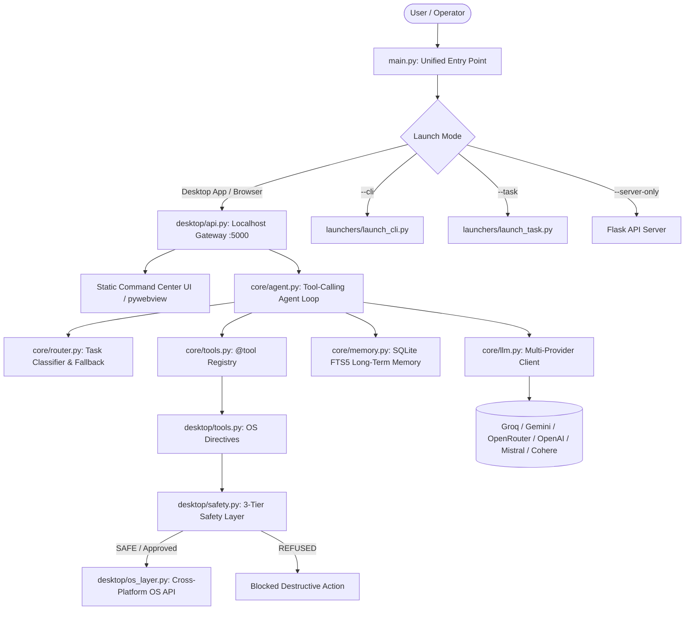

# NEXUS v2 — J.A.R.V.I.S. Desktop AI Assistant

A cross-platform (Windows primary, macOS/Linux supported) desktop AI operating partner and digital command center featuring a unified multi-provider LLM client with fallback, native function/tool calling agent loop, long-term memory (SQLite FTS5), smart task routing, desktop hardware controls with a 3-tier safety layer, push-to-talk voice, real-time telemetry, and an Iron Man Arc Reactor HUD native window.

---

## 🏗️ System Architecture & Workflow



---

## ⚡ Core Capabilities & Subsystems

### 1. Unified Multi-Provider LLM Engine (`core/llm.py` & `config.yaml`)
- **One OpenAI-Compatible Client**: Seamless integration for **Groq**, **Gemini** (via OpenAI-compatible endpoint with `x-goog-api-key`), **OpenRouter**, **OpenAI**, **Mistral**, and **Cohere**.
- **Automated Fallback**: Implements `chat_with_fallback()` with exponential backoff. If the active model hits rate limits or downtime, it automatically rolls over through the configured chain.
- **Zero Hardcoding**: All endpoints, models, and fallback chains are declared in `config.yaml`.

### 2. Autonomous Agent & Dynamic Schema Generator (`core/agent.py` & `core/tools.py`)
- **Native Tool Calling**: Iterative multi-step agent loop (`run_agent`) using OpenAI function calling schemas rather than brittle regex parsing.
- **`@tool` Decorator**: Auto-generates JSON Schema specifications directly from Python type annotations and docstrings.
- **Context Injection**: Pre-fetches and injects relevant user facts from long-term memory into the system prompt on each turn.

### 3. Three-Tier Safety System (`desktop/safety.py` & `desktop/os_layer.py`)
- **`SAFE` (Auto-executed)**: Read-only queries, web search, screenshots, app launching, window listings, volume control.
- **`CONFIRM` (User Approval Required)**: File modifications, closing apps, screen locking, clipboard writes, shell commands.
- **`REFUSED` (Permanently Blocked)**: Destructive commands (`rm -rf /`, `format`, `del /s C:\`, fork bombs, raw drive writes).
- **Execution Security**: Complete elimination of `shell=True` across the codebase; subprocess invocations use explicit argument lists.

### 4. Long-Term Memory via SQLite FTS5 (`core/memory.py`)
- **Full-Text Search Store**: Persistent SQLite FTS5 storage (`~/.nexuschat/history.db`) for user facts, technical preferences, and project context.
- **Automated Sync & Deduplication**: SQLite triggers maintain index synchronization across inserts, updates, and deletions, paired with keyword sanitization.

### 5. J.A.R.V.I.S. Telemetry & Hardware Diagnostics (`core/jarvis_engine.py`)
- **Live System Metrics**: Continuous monitoring of CPU, RAM, Disk, Battery status, and Uptime via `psutil`.
- **Audio & Assistant Protocols**: Push-to-talk audio recording with Whisper STT, offline `pyttsx3` TTS, scheduled timers, and executive morning briefings.

### 6. Digital Command Center Frontend (`frontend/ai/` & `frontend/static/`)
- **Modern UI**: React 19, TypeScript, and Tailwind CSS command center.
- **Engineering Modes**: Instant toggling between `ENGINEERING`, `ARCHITECTURE`, `ROBOTICS`, and `SIMULATION`.
- **Virtual Code Sandbox**: Run and test C / TypeScript / Python routines directly in the interface.

---

## 🚀 Quickstart

### 1. Installation

Python 3.11+ is supported. Install dependencies:

```bash
# Core dependencies
pip install -r requirements.txt

# Native desktop window, tray, and audio extensions
pip install -r requirements-desktop.txt
```

### 2. Configure Environment (`.env`)

Copy `.env.example` to `.env` and insert your API keys:

```bash
cp .env.example .env
```

```env
GROQ_API_KEY="your_groq_key_here"
GEMINI_API_KEY="your_gemini_key_here"
OPENROUTER_API_KEY="your_openrouter_key_here"
OPENAI_API_KEY="your_openai_key_here"
NEXUS_API_KEY="auto-generated-on-first-run-if-empty"
```

### 3. Run NEXUS v2

```bash
# Launch Native Desktop Window (pywebview or Chrome/Edge app mode)
python main.py

# Launch in default browser instead of native window
python main.py --browser

# Run terminal interactive chat
python main.py --cli

# Run hands-free voice task assistant
python main.py --task

# Run API backend only (headless)
python main.py --server-only

# Verify module integrity
python main.py --check
```

---

## 🧪 Testing & Evaluation Benchmarks

### Module Import Integrity Check

Verifies that all 17 core modules, safety layers, and launchers import successfully:

```bash
python main.py --check
```
*Result: 17/17 Modules OK.*

### 20-Question Evaluation Benchmark

Run the standardized 20-question evaluation benchmark covering coding classification, GATE engineering theory, safety tier enforcement, and FTS5 memory recall:

```bash
python evals/run_evals.py
```
*Result: 20/20 Passed (100.0% Pass Rate).*

### Unit Test Suite

Run automated pytest unit test suites:

```bash
python -m pytest -v
```

---

## 🌐 REST API Endpoints

| Endpoint | Method | Description |
| :--- | :--- | :--- |
| `/health` | `GET` | Service health status and version |
| `/profile` | `GET` | Operator profile and system status |
| `/system/telemetry` | `GET` | Real-time CPU, RAM, Battery, Disk, and Uptime |
| `/api/chat` | `POST` | Command Center chat with mode context, tool calling & routing |
| `/api/code/run` | `POST` | Virtual sandbox code compilation & execution |
| `/api/voice` | `POST` | Voice directive recognition and acknowledgment |
| `/chat` | `POST` | Agent chat with tool calling, smart routing & memory |
| `/chat/stream` | `POST` | Server-Sent Events (SSE) streaming chat endpoint |
| `/confirm/pending`| `GET` | List pending confirmation requests (CONFIRM-tier actions) |
| `/confirm` | `POST` | Approve or deny a pending action (`{ "confirmation_id": "...", "action": "approve" }`) |
| `/tools` | `GET` | List all registered tool JSON Schemas |
| `/memory` | `GET` / `POST` | Inspect and store long-term FTS5 facts |
| `/system/action` | `POST` | Execute OS action (`lock_workstation`, `minimize_all`, `volume_up`, `take_screenshot`) |
| `/jarvis/briefing` | `GET` | Executive morning / daily status report |
| `/jarvis/timers` | `GET` | List active timers and pop fired alerts |
| `/jarvis/timer` | `POST` | Schedule a background timer (`{ "seconds": 300, "label": "Break" }`) |

---

## 📁 Repository Structure

```
NEXUS_Chat_Upgraded/
├── main.py                    # Single entrypoint for all modes
├── config.yaml                # Providers, models, routes & fallback chains
├── requirements.txt           # Core dependencies
├── requirements-desktop.txt   # Native desktop UI & voice dependencies
├── .env.example               # Environment variables template
├── core/                      # Foundation layer (unified LLM, agent, memory, router, jarvis)
├── desktop/                   # Desktop automation, 3-tier safety, voice, Flask gateway
├── frontend/                  # Web command centers
│   ├── ai/                    # Modern React 19 + TypeScript + Tailwind Command Center
│   └── static/                # Static assets & bundled web distribution
├── launchers/                 # Mode runners (CLI, voice task)
├── tests/                     # Automated unit & security test suites
├── evals/                     # 20-question standardized evaluation benchmark
└── docs/                      # Architecture, API & Master Prompt references
```

---

## 🔒 Security Guarantees

- **No Hardcoded Keys**: API keys are loaded solely from environment variables or `.env`. If `NEXUS_API_KEY` is not found, a cryptographically secure token is generated via `secrets.token_urlsafe(32)`.
- **Localhost Binding**: API strictly binds to `127.0.0.1` and CORS is restricted to localhost origins only.
- **Header Authentication**: Gemini API keys are sent via `x-goog-api-key` header rather than exposed in query strings.
- **No Unsanitized Shell Calls**: `shell=True` has been completely eliminated in favor of explicit argument lists and safety checks.

