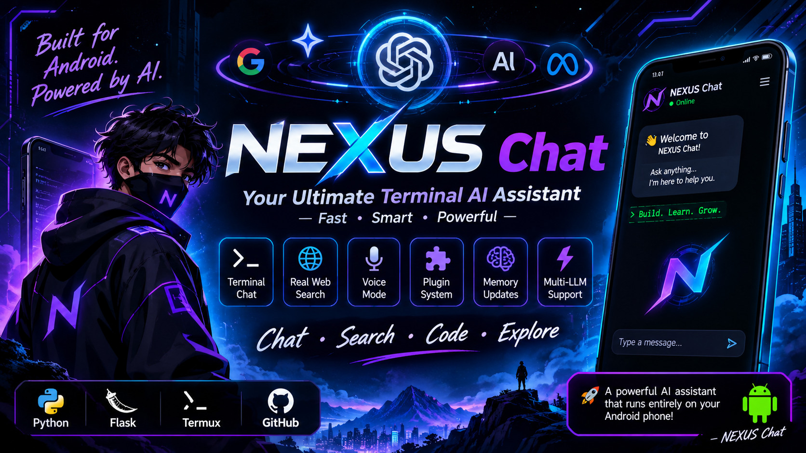
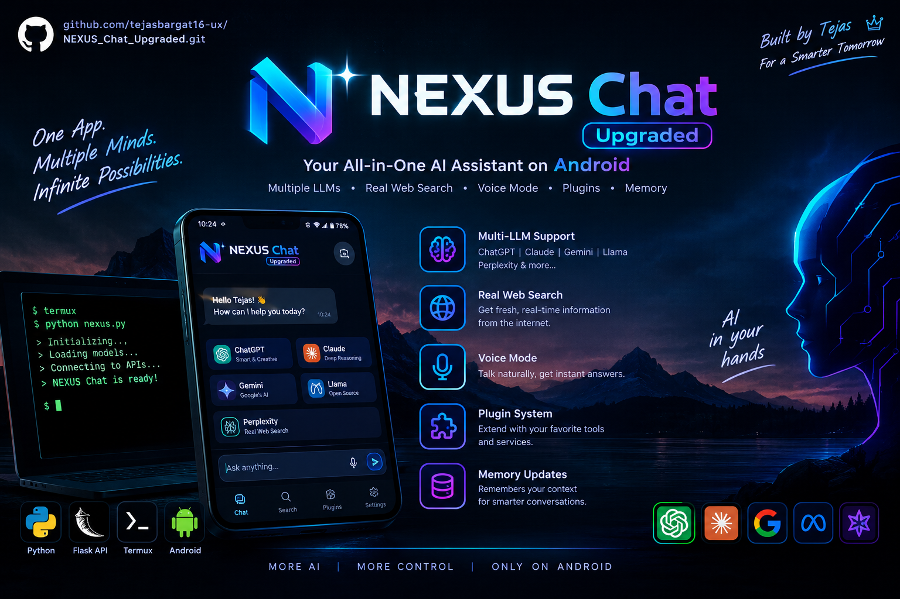
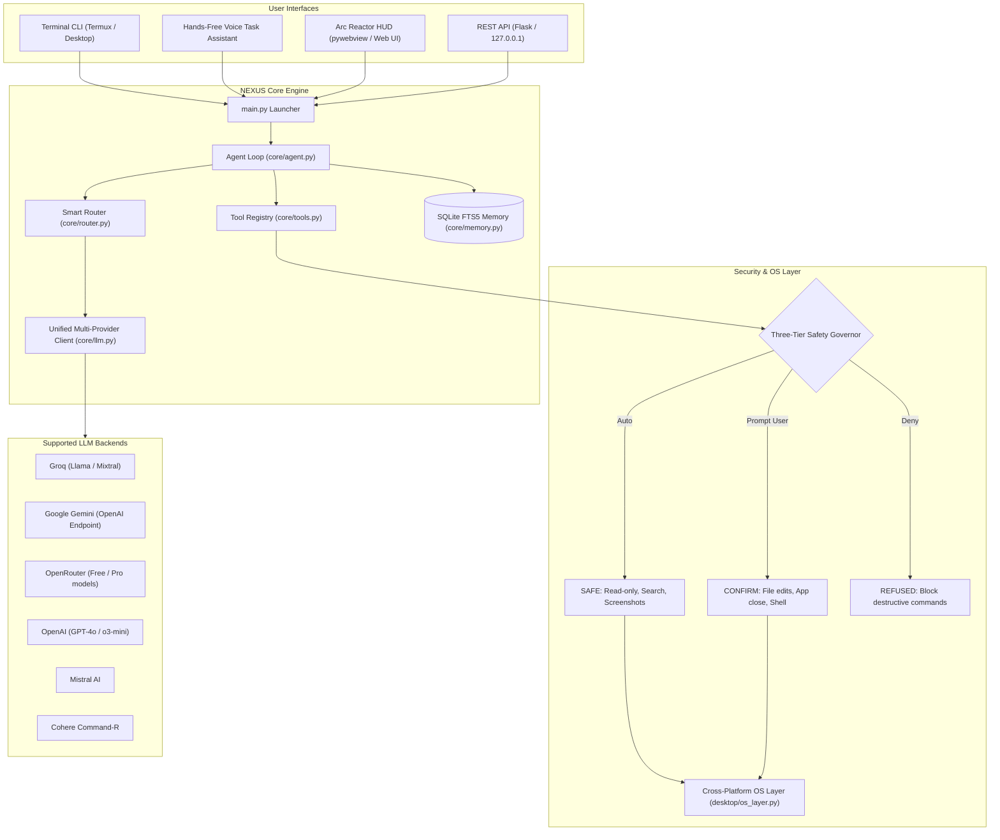

<p align="center">
  
</p>

# ⚡ NEXUS Chat [Upgraded] — J.A.R.V.I.S. AI Operating Partner

**Your All-in-One AI Assistant on Android & Cross-Platform Desktop**

<p align="center">
  <a href="https://www.python.org/"></a>
  <a href="https://flask.palletsprojects.com/"></a>
  <a href="https://www.sqlite.org/"></a>
  <a href="https://termux.dev/"></a>
  <a href="https://github.com/tejasbargat16-ux/NEXUS_Chat_Upgraded"></a>
</p>

> **"One App. Multiple Minds. Infinite Possibilities."**  
> *Built for Android & Cross-Platform Desktop — Fast • Smart • Powerful.*

<p align="center">
  
</p>

---

## ⚡ Overview

**NEXUS v2** is a cross-platform (Windows primary, macOS/Linux supported, and Android Termux ready) desktop AI operating partner and digital command center. It combines unified multi-provider LLM failover, an autonomous tool-calling agent loop, long-term SQLite FTS5 memory, real-time hardware telemetry, push-to-talk voice, and a 3-tier safety execution model into a unified assistant architecture.

---

## ✨ Key Pillars & Features

| Feature | Details |
|---|---|
| 🔀 **Multi-LLM Routing** | Unified provider routing across **Groq**, **Gemini**, **OpenRouter**, **OpenAI (ChatGPT)**, **Mistral**, and **Cohere** with automatic exponential fallback |
| 🌐 **Real Web Search** | Real-time fresh context retrieval using DuckDuckGo and Tavily API |
| 🎙️ **Voice Mode (I/O)** | Push-to-talk natural speech input with Whisper STT and offline/online TTS (`pyttsx3` / `termux-tts-speak`) |
| 🧩 **Plugin & Tool Calling System** | Autonomous `@tool` decorated functions auto-generating JSON Schemas for file operations, app control, system actions, and web browsing |
| 🧠 **Persistent SQLite FTS5 Memory** | Long-term memory store for user facts, preferences, and goals with contextual recall (`/remember`, `/profile`, `/forget`) |
| 🛡️ **Three-Tier Safety Layer** | Built-in security governor categorizing commands into `SAFE` (auto-run), `CONFIRM` (user prompt), and `REFUSED` (destructive command blocklist) |
| 🖥️ **Universal Deployment** | Runs natively in **Android Termux** terminal CLI, desktop native Arc Reactor HUD (`pywebview` + system tray / browser app mode), or headless REST API |
| 📊 **Real-Time Telemetry & J.A.R.V.I.S. Engine** | Live CPU, RAM, Battery, Disk metrics, executive morning briefings, and background timers |

---

## 🏗️ System Architecture & Workflow



---

## ⚡ Core Capabilities & Subsystems

### 1. Unified Multi-Provider LLM Engine (`core/llm.py` & `config.yaml`)
- **One OpenAI-Compatible Client**: Seamless integration for **Groq**, **Gemini** (via OpenAI-compatible endpoint with `x-goog-api-key`), **OpenRouter**, **OpenAI**, **Mistral**, and **Cohere**.
- **Automated Fallback**: Implements `chat_with_fallback()` with exponential backoff. If the active model hits rate limits or downtime, it automatically rolls over through the configured chain.
- **Zero Hardcoding**: All endpoints, models, and fallback chains are declared in `config.yaml`.

### 2. Autonomous Agent & Dynamic Schema Generator (`core/agent.py` & `core/tools.py`)
- **Native Tool Calling**: Iterative multi-step agent loop (`run_agent`) using OpenAI function calling schemas rather than brittle regex parsing.
- **`@tool` Decorator**: Auto-generates JSON Schema specifications directly from Python type annotations and docstrings.
- **Context Injection**: Pre-fetches and injects relevant user facts from long-term memory into the system prompt on each turn.

### 3. Three-Tier Safety System (`desktop/safety.py` & `desktop/os_layer.py`)
- **`SAFE` (Auto-executed)**: Read-only queries, web search, screenshots, app launching, window listings, volume control.
- **`CONFIRM` (User Approval Required)**: File modifications, closing apps, screen locking, clipboard writes, shell commands.
- **`REFUSED` (Permanently Blocked)**: Destructive commands (`rm -rf /`, `format`, `del /s C:\`, fork bombs, raw drive writes).
- **Execution Security**: Complete elimination of `shell=True` across the codebase; subprocess invocations use explicit argument lists.

### 4. Long-Term Memory via SQLite FTS5 (`core/memory.py`)
- **Full-Text Search Store**: Persistent SQLite FTS5 storage (`~/.nexuschat/history.db`) for user facts, technical preferences, and project context.
- **Automated Sync & Deduplication**: SQLite triggers maintain index synchronization across inserts, updates, and deletions, paired with keyword sanitization.

### 5. J.A.R.V.I.S. Telemetry & Hardware Diagnostics (`core/jarvis_engine.py`)
- **Live System Metrics**: Continuous monitoring of CPU, RAM, Disk, Battery status, and Uptime via `psutil`.
- **Audio & Assistant Protocols**: Push-to-talk audio recording with Whisper STT, offline `pyttsx3` TTS, scheduled timers, and executive morning briefings.

### 6. Digital Command Center Frontend (`frontend/ai/` & `frontend/static/`)
- **Modern UI**: React 19, TypeScript, and Tailwind CSS command center.
- **Engineering Modes**: Instant toggling between `ENGINEERING`, `ARCHITECTURE`, `ROBOTICS`, and `SIMULATION`.
- **Virtual Code Sandbox**: Run and test C / TypeScript / Python routines directly in the interface.

---

## 🚀 Quickstart Guide

### 📱 Android / Termux Setup

```bash
# 1. Update and install base packages
pkg update && pkg install python git termux-api -y

# 2. Clone the repository
git clone https://github.com/tejasbargat16-ux/NEXUS_Chat_Upgraded.git
cd NEXUS_Chat_Upgraded

# 3. Install core dependencies
pip install -r requirements.txt

# 4. Configure environment
cp .env.example .env
nano .env

# 5. Launch terminal CLI
python main.py --cli
```

### 💻 Desktop Setup (Windows / macOS / Linux)

```bash
# 1. Clone repository
git clone https://github.com/tejasbargat16-ux/NEXUS_Chat_Upgraded.git
cd NEXUS_Chat_Upgraded

# 2. Install core and desktop GUI / audio extensions
pip install -r requirements.txt
pip install -r requirements-desktop.txt

# 3. Setup environment variables
cp .env.example .env
```

Edit `.env` with your API keys (you only need one provider to start; NEXUS auto-selects available providers):

```env
GROQ_API_KEY="your_groq_key"
GEMINI_API_KEY="your_gemini_key"
OPENROUTER_API_KEY="your_openrouter_key"
OPENAI_API_KEY="your_openai_key"
TAVILY_API_KEY="your_tavily_key"      # Optional: for web search
NEXUS_API_KEY="auto-generated-if-empty"
```

---

## ▶️ Running Modes

`main.py` provides a single unified entry point for all operating modes:

```bash
# 1. Launch Native Desktop Window (pywebview or Chrome/Edge app mode) + System Tray
python main.py

# 2. Launch in Browser (Localhost Web HUD)
python main.py --browser

# 3. Run Interactive Terminal CLI (Optimized for Termux / Desktop)
python main.py --cli

# 4. Run Dedicated Hands-Free Voice Assistant
python main.py --task

# 5. Run Headless REST API Server
python main.py --server-only

# 6. Verify System & Dependency Integrity
python main.py --check
```

---

## ⌨️ Interactive CLI Commands

| Command | Action |
|---|---|
| `/new` | Start a fresh chat conversation |
| `/sessions` | List saved conversation history |
| `/load <id>` | Resume a previous conversation |
| `/remember <fact>` | Store a fact or preference in persistent SQLite memory |
| `/profile` | Display all saved user profile facts |
| `/forget all` | Wipe stored user profile facts |
| `/provider <name>` | Switch active LLM provider (`groq`, `gemini`, `openrouter`, `openai`, `mistral`, `cohere`) |
| `/model <name>` | Change model under current provider |
| `/models` | View suggested models for active provider |
| `/voice on` / `/voice off` | Toggle spoken output and push-to-talk mic input |
| `/task` | Launch hands-free voice task assistant |
| `/search <query>` | Trigger instant web search |
| `/image <prompt>` | Generate images via Pollinations.ai or Gemini |
| `/clear` | Clear terminal screen |
| `/exit` | Exit application |

---

## 🧪 Testing & Evaluation Benchmarks

### Module Import Integrity Check

Verifies that all 17 core modules, safety layers, and launchers import successfully:

```bash
python main.py --check
```
*Result: 17/17 Modules OK.*

### 20-Question Evaluation Benchmark

Run the standardized 20-question evaluation benchmark covering coding classification, GATE engineering theory, safety tier enforcement, and FTS5 memory recall:

```bash
python evals/run_evals.py
```
*Result: 20/20 Passed (100.0% Pass Rate).*

### Unit Test Suite

Run automated pytest unit test suites:

```bash
python -m pytest -v
```

---

## 🌐 REST API Endpoints

The built-in Flask API server (`desktop/api.py`) runs at `http://127.0.0.1:5000`:

| Endpoint | Method | Description |
| :--- | :--- | :--- |
| `/health` | `GET` | Service status, uptime, and active version |
| `/profile` | `GET` | Operator profile and system status |
| `/system/telemetry` | `GET` | Real-time CPU, RAM, Battery, Disk, and Uptime |
| `/api/chat` | `POST` | Command Center chat with mode context, tool calling & routing |
| `/api/code/run` | `POST` | Virtual sandbox code compilation & execution |
| `/api/voice` | `POST` | Voice directive recognition and acknowledgment |
| `/chat` | `POST` | Agent chat with tool calling, smart routing & memory |
| `/chat/stream` | `POST` | Server-Sent Events (SSE) streaming chat |
| `/confirm/pending` | `GET` | Retrieve pending CONFIRM-tier action requests |
| `/confirm` | `POST` | Approve or deny a pending action |
| `/tools` | `GET` | List all registered tool JSON Schemas |
| `/memory` | `GET` / `POST` | Query or inspect long-term FTS5 facts |
| `/system/action` | `POST` | Perform OS actions (lock workstation, volume, screenshot) |
| `/jarvis/briefing` | `GET` | Daily executive morning brief |
| `/jarvis/timers` | `GET` / `POST` | Inspect and schedule background timers |

---

## 📁 Repository Structure

```
NEXUS_Chat_Upgraded/
├── assets/                     # Visual banners & architecture overviews
│   ├── banner.png              # Header visual poster
│   └── overview.png            # Android & system architecture graphic
├── config.yaml                 # Providers, models, routes & fallback chains
├── main.py                     # Unified entry point for all modes
├── requirements.txt            # Core dependencies
├── requirements-desktop.txt    # Desktop GUI, tray, and audio extensions
├── .env.example                # Environment configuration template
├── core/                       # Core engine: LLM client, agent loop, tools, memory, router, jarvis
├── desktop/                    # OS layer, safety governor, voice, native UI, Flask API
├── frontend/                   # Web command centers
│   ├── ai/                     # Modern React 19 + TypeScript + Tailwind Command Center
│   └── static/                 # Static assets & bundled web distribution
├── launchers/                  # Mode launchers (CLI, voice task, desktop)
├── tests/                      # Automated test suite (38 unit & security tests)
├── evals/                      # 20-question standardized evaluation benchmark
└── docs/                       # Architecture and API documentation
```

---

## 🛡️ Security Guarantees

- **No Hardcoded Keys**: API keys are isolated in `.env` and environment variables. If `NEXUS_API_KEY` is omitted, a 32-byte secure token is generated automatically via `secrets.token_urlsafe(32)`.
- **Localhost Bound**: The API server strictly binds to `127.0.0.1` with restricted CORS.
- **Header Authentication**: Gemini API keys are sent via `x-goog-api-key` header rather than exposed in query strings.
- **No Unsanitized Shell Calls**: `shell=True` has been completely eliminated in favor of explicit argument arrays.
- **Three-Tier Safety Filter**: Dangerous commands (`rm -rf`, format disks, fork bombs) are refused unconditionally.

---

## 👤 Author

**Tejas Bargat**  
*2nd-year B.Tech ECE (Minor in CSE), TGPCET Nagpur*  
*“Built by Tejas 👑 — For a Smarter Tomorrow”*  

[](https://github.com/tejasbargat16-ux)
[](https://www.linkedin.com/in/tejas-bargat-9ab8523b0)
[](https://github.com/tejasbargat16-ux/NEXUS_Chat_Upgraded)

---

⭐ If this project helped or inspired you, consider starring the repo!
